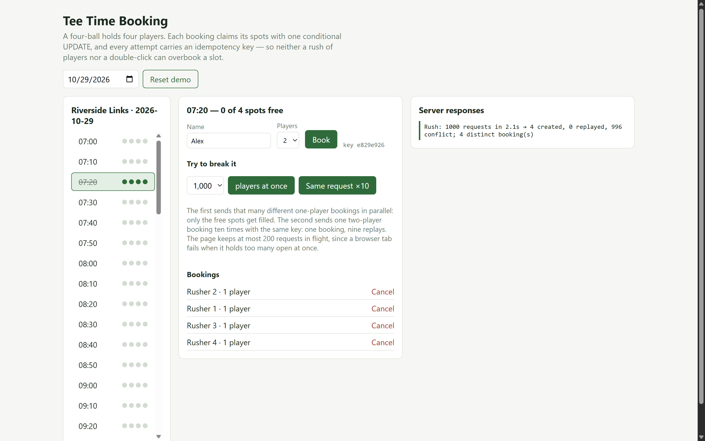

# Tee Time Booking — concurrent and duplicate requests, done right

[](https://github.com/nelinkolya/tee-time-booking-demo/actions/workflows/ci.yml)

A minimal golf tee-time booking API (ASP.NET Core 10, EF Core 10, SQL Server) with a React UI, built to show
one thing: **no matter how requests race or repeat, a tee time never holds more players than it has spots,
and one booking attempt never becomes two bookings.**



## The two problems

| Problem | Example | Wrong fix | What this project does |
|---|---|---|---|
| **Concurrent requests** from different people | 20 players want the last 4 spots of the 07:30 four-ball | "Is there room? Then insert" in C# — both requests see room, both insert | The capacity check and the claim are **one conditional `UPDATE`**; the database serialises bookings per tee time |
| **Duplicate requests** from one person | Double-click, mobile retry after a timeout | Disable the button (doesn't stop retries) | **Idempotency key** per booking attempt, stored under a **unique index** |

## How it works

```sql
-- one statement: check and claim, no window in between
UPDATE TeeTimes SET BookedPlayers = BookedPlayers + @players
WHERE Id = @id AND BookedPlayers + @players <= Capacity;   -- 0 rows → full (409)
```

`BookingService.BookAsync` (`TeeTimeBooking.Api/Bookings/BookingService.cs`):

1. **Replay check.** A booking with this `Idempotency-Key` already exists → return it (`200`, header
   `Idempotent-Replayed: true`). Same key with a different request → `422`.
2. **Claim the spots** with the conditional `UPDATE` inside a transaction. It locks that tee-time row until
   commit, so competing bookings for the *same* slot queue behind it; other slots are not blocked.
3. **0 rows claimed** → look for the key once more (a twin copy may have taken the last spots while this one
   waited on the lock — that is a replay, not "full"), otherwise `409` with the spots left.
4. **Insert the booking.** If two copies with the same key raced past step 1, the unique index rejects the
   second; it rolls back — which also returns the spots it claimed — and returns the winner's booking.

Defence in depth: a check constraint `0 <= BookedPlayers <= Capacity`, so even a buggy code path cannot
overbook. Cancellation flips the status with a conditional `UPDATE` too, so five parallel cancels free the
spots once.

**Why not a queue (RabbitMQ)?** It only removes the race with one consumer per tee time, it delivers
at-least-once (so the consumer must be idempotent anyway), some bookings bypass it (staff, integrations), and
the player gets an asynchronous answer. A queue can absorb a peak; the guarantee stays in the database.

**Why not a Redis lock?** Locks expire and fail over; the constraint is the guarantee.

Booking ids are the clustered key, so they are **sequential GUIDs** (EF Core's `SequentialGuidValueGenerator`),
not `Guid.NewGuid()`: new rows append to the last page instead of splitting random ones. A test checks the order
with SQL Server's own `ORDER BY Id` — .NET and SQL Server sort GUIDs differently, which is also why
`Guid.CreateVersion7()` would not help here.

## Tests — 37, against a real SQL Server

Concurrency bugs don't show up against an in-memory provider, so the suite runs against SQL Server and fires
requests through the real HTTP pipeline, all released at once from one gate.

| Test | Proves |
|---|---|
| 20 parallel 1-player requests on a 4-ball | exactly 4 × `201`, 16 × `409`, counter = 4 |
| two groups of 3 racing | one wins |
| 40 random group sizes under load | never overbooked; counter matches bookings |
| different tee times in parallel | no cross-slot blocking |
| 10 simultaneous copies, same key | 1 × `201`, 9 × `200`, one booking id |
| copies that take the last spots | the losers get the booking, not `409` |
| same key, different request | `422` |
| 5 parallel cancels | spots freed once |
| **naive check-then-insert** | **overbooks a 4-ball to 6 players** — why the service doesn't do that |
| DB check constraint | rejects a counter above capacity |
| **load:** 1,000 requests at once on one 4-ball | exactly 4 × `201`, 996 × `409` (~0.5 s) |
| **load:** 1,100 requests over 100 tee times, every 10th sent twice with the same key | no slot over capacity, counters match bookings, no key booked twice |

Load tests carry `Category=Load`: `dotnet test --filter Category!=Load` skips them.

The tests were mutation-checked: removing the capacity condition fails 5 of them; removing the twin re-check
in step 3 fails the "last spots" test.

## Run

```
# connection strings live in user secrets, never in appsettings
dotnet user-secrets set ConnectionStrings:TeeTimes     "Server=...;Database=TeeTimeBooking;..."      --project TeeTimeBooking.Api
dotnet user-secrets set ConnectionStrings:TeeTimesTest "Server=...;Database=TeeTimeBooking_Test;..." --project TeeTimeBooking.Tests

dotnet test TeeTimeBooking.slnx                 # drops and re-migrates *_Test only; refuses any other name
dotnet run --project TeeTimeBooking.Api         # http://localhost:5110, migrates and seeds a week of tee times
cd web && npm install && npm run dev            # http://localhost:5173, proxies /api to the API
```

## Docker

One image (`Dockerfile`, three stages): Node builds the React app, the .NET SDK publishes the API, and the final
image holds only the ASP.NET runtime, the published API and the UI in `wwwroot`. The API serves the UI itself —
one origin, no proxy, no CORS; unknown paths fall back to `index.html`, except under `/api`, which stays a 404.
The container runs as the non-root `app` user, in `Production` (no Swagger, no demo reset), on port 8080, and
exposes `GET /health` (checks the database) for an orchestrator's probes.

```
cp .env.example .env            # put the real connection string in .env — it is git-ignored
docker compose up --build       # app on http://localhost:8080, Aspire dashboard on http://localhost:18888
```

`docker-compose.yml` runs the app next to the **Aspire dashboard**, with `OTEL_EXPORTER_OTLP_ENDPOINT` pointing at
it, so traces, metrics and structured logs are visible in a browser with no further setup. SQL Server is not in
the compose file: it is expected on the Docker host (`host.docker.internal`). The connection string reaches the
container only as the `ConnectionStrings__TeeTimes` environment variable, never in the image.

## Live demo

**https://teetime-booking.yellowrock-3c024f16.swedencentral.azurecontainerapps.io** — Azure, free tiers. It scales
to zero and the database auto-pauses, so the first request after a quiet spell can take up to a minute.

| Piece | Azure resource |
|---|---|
| App | Container Apps (Consumption), 0.25 vCPU, 0–1 replicas, image from `ghcr.io/nelinkolya/tee-time-booking-demo` |
| Database | Azure SQL Database free offer (serverless, auto-pause when the monthly free amount runs out) |
| Database login | the app's **managed identity** — no password anywhere; the SQL server accepts Entra authentication only |
| Telemetry | Application Insights via the OpenTelemetry Azure Monitor exporter (`APPLICATIONINSIGHTS_CONNECTION_STRING`) |
| Migrations | a Container Apps **job** (`--migrate`) with its own identity — the only one allowed to change the schema; the app runs with `Database__MigrateOnStartup=false` |
| Infrastructure | all of it in **Bicep** (`infra/main.bicep`, see `infra/README.md`) |

Every `main` that passes CI is deployed automatically: the image is published, the migration job runs with it
(a failed migration stops here, before any revision is created), the container app is updated to it, and the job waits until the new revision is ready and serving that exact image. GitHub signs in to Azure with
**OIDC** — the federated credential trusts only this repository's `production` environment, which only `main` may
deploy to; the role is Contributor on one resource group, and no secret is stored in GitHub.

## CI

GitHub Actions (`.github/workflows/ci.yml`), on every push to `main` and every pull request — five jobs:

| Job | What it proves |
|---|---|
| **Tests (SQL Server)** | all tests except the load tests, against a real SQL Server 2022 container; results uploaded as a `.trx` artifact |
| **Web build** | the React app type-checks and builds from the lockfile |
| **Docker image smoke test** | the image builds from the `Dockerfile`, runs in Production against SQL Server, migrates, reports `/health` healthy, serves the UI and the API, and leaves out the demo reset and the API docs |
| **Publish image** | after all three pass on `main`: the image is pushed to `ghcr.io` tagged with the commit and `latest` |
| **Deploy to Azure** | after publishing: rolls the image out to Container Apps via OIDC and checks the new revision serves it |

A newer push cancels the checks still running for an older one, but never a deployment: deployments run one at a
time and always finish, including their verification.

The load tests run only on demand: Actions → CI → **Run workflow** with **Run load tests** ticked, or
`gh workflow run ci.yml -f load_tests=true`.

The SQL Server `sa` password is generated per run, masked in the log, and never stored in the repository
(`.github/scripts/start-sqlserver.sh`).

## Observability

One **OpenTelemetry** pipeline for traces, metrics and logs (`Program.cs`, `Observability/BookingTelemetry.cs`).

| Signal | What |
|---|---|
| **Traces** | ASP.NET Core request → `BookTeeTime` span (tags `teetime.id`, `booking.players`, `booking.outcome`, `booking.id`) → SQL commands |
| **Metrics** | `teetime.booking.attempts` by `booking.outcome` (created / replayed / full / key_reused / not_found / error), `teetime.booking.players`, `teetime.booking.duration` (histogram, s), `teetime.booking.cancellations`; plus built-in `http.server.request.duration` and `System.Runtime` |
| **Logs** | structured, source-generated (`[LoggerMessage]`): `TeeTimeId`, `BookingId`, `IdempotencyKey`, `Players` as named properties; JSON on the console, with `TraceId`/`SpanId` in scope. The player's name is never logged |

Metric tags stay low-cardinality (outcome only); per-request ids go on spans and logs. A handled collision of two
copies of one request is logged as Information — EF's own "Failed executing DbCommand" is lowered to Debug, and an
unhandled failure is still logged as an error by the exception handler. Tests pin the metric names, span tags, log
properties and the absence of error logs for handled duplicates.

**Watch it locally:**

```
dotnet tool restore
dotnet tool run dotnet-counters monitor -n TeeTimeBooking.Api --counters TeeTimeBooking,Microsoft.AspNetCore.Hosting
```

**Export:** set `OTEL_EXPORTER_OTLP_ENDPOINT` and everything goes out over OTLP — e.g. to the Aspire dashboard
(`docker run -p 18888:18888 -p 4317:18889 mcr.microsoft.com/dotnet/aspire-dashboard:13.6`, then
`OTEL_EXPORTER_OTLP_ENDPOINT=http://<host>:4317`), Jaeger, Grafana or Azure Monitor.

## API

Interactive docs outside production: **Swagger UI at `/swagger`** (also linked from the UI header as
"API docs"), rendering the built-in OpenAPI 3.1 document at `/openapi/v1.json`. The document lists every
response of each operation, the `Idempotency-Key` header, and problem+json error bodies; a test pins that.

| Method | Route | Notes |
|---|---|---|
| `GET` | `/api/tee-times?date=yyyy-MM-dd` | slots with booked / free spots |
| `GET` | `/api/tee-times/{id}/bookings` | |
| `POST` | `/api/tee-times/{id}/bookings` | header `Idempotency-Key`; body `{ playerName, players }` → `201` / `200` replay / `409` full / `422` key reused / `400` / `404` |
| `POST` | `/api/bookings/{id}/cancel` | idempotent |
| `GET` | `/api/version` | release, commit and build time |
| `POST` | `/api/demo/reset` | Development only |

**Rate limits** (per client IP, `429` with `Retry-After`): bookings and cancels 1,100 per 10 minutes — one
1,000-player rush from the UI, not a flood — and other API calls 600 a minute.

## Out of scope

Auth, payments/deposits, holds with expiry for multi-step checkout, time zones per course (times are
course-local), expiry of old idempotency keys. With PostgreSQL and free-form time ranges instead of fixed
slots, the equivalent guarantee is an exclusion constraint (`EXCLUDE USING gist (... WITH &&)`).
